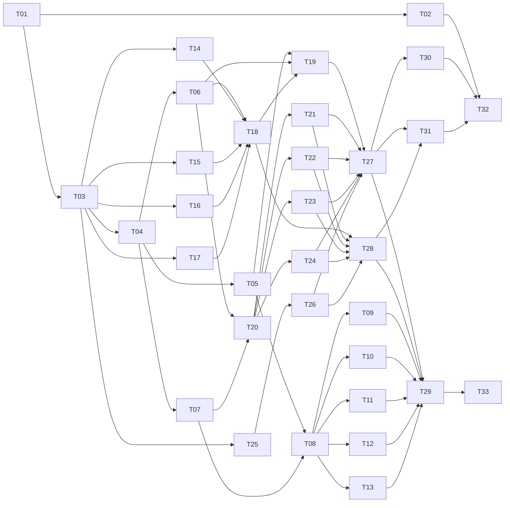

# v0.1 Task Breakdown

The v0.1 scope from [`PRD.md`](../PRD.md) is split into small, self-contained tasks. Each task is sized for **one agent session** and produces **one reviewable PR**.

## How to Run a Task

1. Pick a task whose dependencies are all `done` (see the index below).
2. Create a branch: `task/<id>-<slug>` (e.g., `task/T05-registry-loader`).
3. Start a **fresh** agent session and run `/implement-task <id>` (e.g., `/implement-task T05`). Agents without slash commands: *"Follow docs/workflows/implement-task.md for task T05."*
4. Optionally, in another fresh session, run `/review-task <id>` for an independent read-only review.
5. Review the diff yourself, run the Verify commands, then merge.

`/commit-changes` commits the working tree when you need a commit outside `/implement-task`. `/pr-summary` drafts the pull request title and description against `main`. Neither command pushes or opens the pull request.

For registry content (T09–T13), `/write-fragment <id>` guides authoring one fragment at a time.

**Why fresh sessions:** a new session starts with a clean context window, so earlier tasks' details don't crowd out the current one. Everything a task needs is in its file, `AGENTS.md`, and the referenced PRD sections.

## Rules for Agents
- Do only what the task's **Scope** lists. Items under **Out of scope** belong to other tasks.
- Small, necessary edits outside the scope (e.g., exporting a type from an earlier module) are fine; mention them in the PR description.
- If the task conflicts with the PRD or the code from a previous task, stop and ask.
- Record decisions or discovered gaps in the task file's **Notes** section.

## Definition of Done (every task)
- [ ] All acceptance criteria in the task file are checked.
- [ ] `pnpm lint && pnpm typecheck && pnpm test && pnpm build` pass.
- [ ] New behavior is covered by tests.
- [ ] PRD updated if behavior was clarified or changed (with the user's approval).
- [ ] Status set to `done` in the index below.
- [ ] One conventional commit (or a few, all conventional), with no co-author trailers.

## Content Tasks (T09–T13) Checklist
Rule and workflow fragments need extra care because agents will follow them literally:
- [ ] Every directive was checked against current official docs for the `appliesTo` version; those URLs are in `sources`.
- [ ] Directives are specific to the library, not generic advice ("write clean code").
- [ ] Each rule fragment has Boundary, Directives (`ALWAYS`/`NEVER`/`PREFER`/`FORBID`/`DEFAULT`), and a Good vs. Anti-Pattern code block.
- [ ] No instructions to move existing files, run network commands, install packages, or read secrets.
- [ ] `pnpm registry:check` passes.
- [ ] A human reviewed the content before merge.

## Dependency Graph

**Parallel waves** (tasks in the same wave can run in separate sessions at the same time):

| Wave | Tasks |
| :--- | :--- |
| 1 | T01 |
| 2 | T02, T03 |
| 3 | T04, T14, T15, T16, T17, T25 |
| 4 | T05, T06, T07, T26 |
| 5 | T08, T18, T20 |
| 6 | T09, T10, T11, T12, T13, T19, T21, T22, T23, T24 |
| 7 | T27, T28 |
| 8 | T29, T30, T31 |
| 9 | T32, T33 |

Running tasks in parallel is optional. When working solo, follow the ID order; it respects every dependency.

## Task Index

Size: **S** ≈ under 1 hour of agent work · **M** ≈ 1–3 hours · **L** ≈ a long session; split it if it doesn't fit.

| ID | Task | Milestone | Depends on | Size | Status |
| :--- | :--- | :--- | :--- | :--- | :--- |
| T00 | Repository agent setup (`AGENTS.md`, `ARCHITECTURE.md`, `CLAUDE.md`, scoped rules, workflows) | — | — | S | done |
| [T01](T01-tooling-setup.md) | Tooling setup | M1 | — | M | todo |
| [T02](T02-ci-and-changesets.md) | CI, changesets, CODEOWNERS | M1 | T01 | S | todo |
| [T03](T03-cli-skeleton.md) | CLI skeleton, types, errors | M1 | T01 | M | todo |
| [T04](T04-fragment-schema-and-parser.md) | Fragment schema & parser | M2 | T03 | M | todo |
| [T05](T05-registry-loader-and-list.md) | Registry loader & `list` | M2 | T04 | M | todo |
| [T06](T06-resolver.md) | Fragment resolver | M2 | T04 | M | todo |
| [T07](T07-placeholders.md) | Placeholder rendering | M2 | T04 | S | todo |
| [T08](T08-check-registry.md) | `check-registry` script | M2 | T05, T07 | M | todo |
| [T09](T09-content-architectures-languages.md) | Content: architectures & languages | M2 | T08 | L | todo |
| [T10](T10-content-frameworks.md) | Content: frameworks | M2 | T08 | L | todo |
| [T11](T11-content-libraries-ui-state.md) | Content: Tailwind, shadcn, TanStack Query, Zustand | M2 | T08 | L | todo |
| [T12](T12-content-libraries-forms-testing.md) | Content: RHF + Zod, Vitest, Playwright | M2 | T08 | M | todo |
| [T13](T13-content-workflows.md) | Content: workflows | M2 | T08 | M | todo |
| [T14](T14-detect-packages.md) | Detect packages & versions | M3 | T03 | M | todo |
| [T15](T15-detect-typescript.md) | TypeScript gate & tsconfig | M3 | T03 | S | todo |
| [T16](T16-detect-layout.md) | Layout & architecture inference | M3 | T03 | M | todo |
| [T17](T17-detect-workspace-and-agents.md) | Monorepo, git root, existing agents | M3 | T03 | S | todo |
| [T18](T18-detect-orchestrator.md) | Detection orchestrator | M3 | T06, T14–T17 | M | todo |
| [T19](T19-interactive-ui.md) | Wizard, summary & `--yes` defaults | M3 | T05, T06, T18 | L | todo |
| [T20](T20-plan-core-and-shared-targets.md) | Plan core, `AGENTS.md`, `ARCHITECTURE.md` | M4 | T06, T07 | L | todo |
| [T21](T21-target-cursor.md) | Cursor target | M4 | T20 | S | todo |
| [T22](T22-target-claude.md) | Claude Code target | M4 | T20 | M | todo |
| [T23](T23-target-windsurf.md) | Windsurf target | M4 | T20 | S | todo |
| [T24](T24-target-copilot.md) | GitHub Copilot target | M4 | T20 | M | todo |
| [T25](T25-manifest-and-managed-blocks.md) | Manifest & managed blocks | M5 | T03 | M | todo |
| [T26](T26-apply-engine.md) | Apply engine | M5 | T25 | L | todo |
| [T27](T27-init-command.md) | `init` command end to end | M5 | T19, T21–T24, T26 | L | todo |
| [T28](T28-doctor-command.md) | `doctor` command | M5 | T18, T21–T24, T26 | M | todo |
| [T29](T29-fixtures-and-acceptance-tests.md) | Fixtures & acceptance tests | M6 | T27, T28, T09–T13 | L | todo |
| [T30](T30-package-smoke-test.md) | Packed-tarball smoke test | M6 | T27 | S | todo |
| [T31](T31-docs-readme-contributing.md) | README & CONTRIBUTING | M6 | T27, T28 | M | todo |
| [T32](T32-release-workflow.md) | Release workflow, dogfooding & launch checklist | M6 | T02, T30, T31 | M | todo |
| [T33](T33-rule-effectiveness-eval.md) | Rule-effectiveness eval (human-led) | M6 | T29 | M | todo |

## Task File Template
Every task file uses the same sections: **Goal**, **Context**, **Scope**, **Out of scope**, **Implementation notes**, **Acceptance criteria**, **Verify**, **Commit**, **Notes**.
