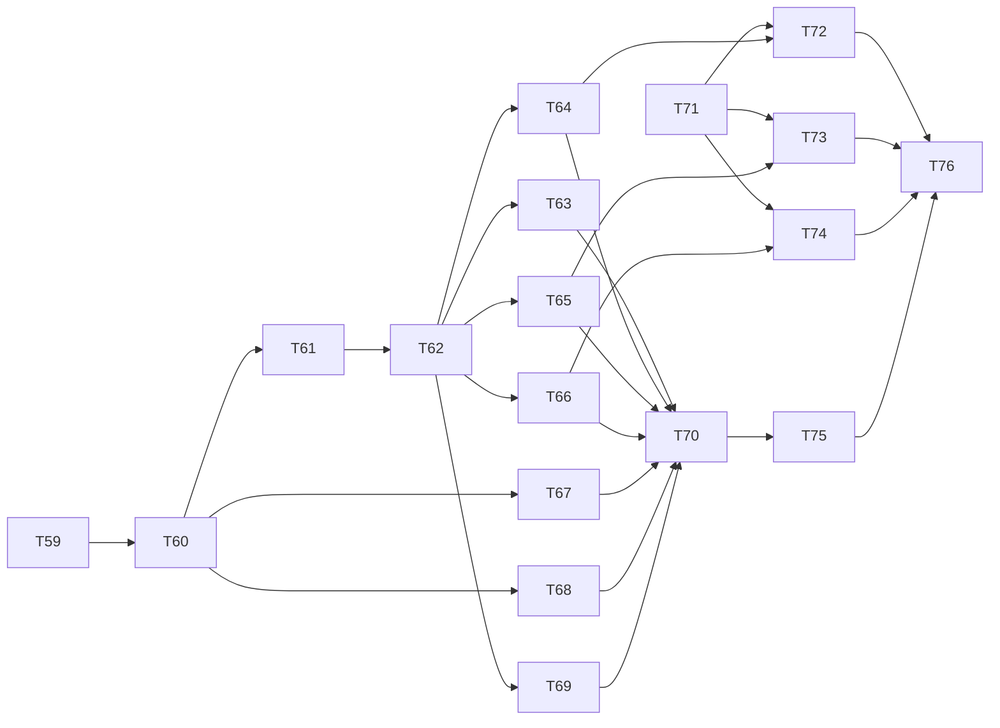

# v0.2 Task Breakdown

The v0.2 scope from [`PRD.md`](../PRD.md) §7 (JavaScript projects and older stacks) is split into small, self-contained tasks. Each task is sized for **one agent session** and produces **one reviewable PR**.

Completed v0.1–0.1.2 tasks (T00–T58) live in [`completed.md`](completed.md). Their task files stay in this folder.

## How to Run a Task

1. Pick a task whose dependencies are all `done` (see the index below). A dependency that is not listed here is in [`completed.md`](completed.md) and is already `done`.
2. Create a branch: `task/<id>-<slug>` (e.g., `task/T60-language-detection`), from `release/0.2` once that branch exists (see **Release branch** below). Until then, this planning work may land on `main`.
3. Start a **fresh** agent session and run `/implement-task <id>` (e.g., `/implement-task T60`). Agents without slash commands: *"Follow docs/workflows/implement-task.md for task T60."*
4. Optionally, in another fresh session, run `/review-task <id>` for an independent read-only review.
5. Review the diff yourself, run the Verify commands, then open a PR into `release/0.2` (or into `main` only for this planning PR).

`/commit-changes` commits the working tree when you need a commit outside `/implement-task`. `/pr-summary` drafts the pull request title and description against the PR's base branch. Neither command pushes or opens the pull request.

For registry content, `/write-fragment <id>` guides authoring one fragment at a time. Content tasks in this release (T59, T63–T66, T72–T74) follow the Content Tasks checklist below.

**Why fresh sessions:** a new session starts with a clean context window, so earlier tasks' details don't crowd out the current one. Everything a task needs is in its file, `AGENTS.md`, and the referenced PRD sections.

## Release branch

0.2 implementation work uses a long-lived `release/0.2` branch:

1. Merge this planning change to `main`, then cut `release/0.2` from `main`.
2. Each task PR targets `release/0.2` (not `main`). CI runs on every pull request; `release.yml` publishes only from `main`.
3. After any 0.1.x patch lands on `main`, merge `main` into `release/0.2`.
4. When T59–T76 are done, T76 merges `release/0.2` into `main`; the Version Packages PR proposes `0.2.0`.

Creating and protecting `release/0.2` is an owner operation listed in [`backlog.md`](backlog.md).

## Rules for Agents
- Do only what the task's **Scope** lists. Items under **Out of scope** belong to other tasks.
- Small, necessary edits outside the scope (e.g., exporting a type from an earlier module) are fine; mention them in the PR description.
- If the task conflicts with the PRD or the code from a previous task, stop and ask.
- Record decisions or discovered gaps in the task file's **Notes** section.
- Tasks with a **Decisions (owner, before starting)** section: stop and ask before writing code; record answers under **Notes** and in the PRD when the task says so.
- **Invariant:** output for existing TypeScript projects without `allowJs` stays byte-identical, apart from intentional new version ranges (T72–T74) and `allowJs` glob widening (T61).

## Definition of Done (every task)
- [ ] All acceptance criteria in the task file are checked.
- [ ] `pnpm lint && pnpm typecheck && pnpm test && pnpm build` pass.
- [ ] New behavior is covered by tests.
- [ ] PRD updated if behavior was clarified or changed (with the user's approval).
- [ ] Status set to `done` in the index below.
- [ ] One conventional commit (or a few, all conventional), with no co-author trailers.

## Content Tasks Checklist
Rule and workflow fragments need extra care because agents will follow them literally:
- [ ] Every directive was checked against current official docs for the `appliesTo` version; those URLs are in `sources`.
- [ ] Directives are specific to the library, not generic advice ("write clean code").
- [ ] Each rule fragment has Boundary, Directives (`ALWAYS`/`NEVER`/`PREFER`/`FORBID`/`DEFAULT`), and a Good vs. Anti-Pattern code block.
- [ ] Dual-language rule fragments (after T62) include TypeScript and JavaScript Contract examples, or an explicit TypeScript-only marker.
- [ ] No instructions to move existing files, run network commands, install packages, or read secrets.
- [ ] `pnpm registry:check` passes.
- [ ] A human reviewed the content before merge.

v0.1 content reviews are recorded in [`completed.md`](completed.md) and in each content task's **Notes**.

## Dependency Graph

**Parallel waves** (tasks in the same wave can run in separate sessions at the same time):

| Wave | Tasks |
| :--- | :--- |
| 23 | T59, T71 |
| 24 | T60 |
| 25 | T61, T67, T68 |
| 26 | T62 |
| 27 | T63, T64, T65, T66, T69 |
| 28 | T70, T72, T73, T74 |
| 29 | T75 |
| 30 | T76 |

Running tasks in parallel is optional. When working solo, follow the ID order; it respects every dependency.

## Task Index

Size: **S** ≈ under 1 hour of agent work · **M** ≈ 1–3 hours · **L** ≈ a long session; split it if it doesn't fit.

| ID | Task | Milestone | Depends on | Size | Status |
| :--- | :--- | :--- | :--- | :--- | :--- |
| [T59](T59-javascript-language-fragments.md) | Content: `javascript` and `javascript-jsdoc` language fragments | M11 | — | M | todo |
| [T60](T60-language-detection.md) | Language detection replaces the TypeScript gate | M11 | T59 | M | todo |
| [T61](T61-language-aware-globs.md) | Language-aware globs | M11 | T60 | M | todo |
| [T62](T62-per-language-examples.md) | Per-language examples: mechanism and registry check | M11 | T61 | M | todo |
| [T63](T63-js-examples-architectures.md) | Content: JavaScript examples for architectures | M11 | T62 | M | todo |
| [T64](T64-js-examples-frameworks.md) | Content: JavaScript examples for frameworks | M11 | T62 | L | todo |
| [T65](T65-js-examples-libraries-ui-state.md) | Content: JS examples for Tailwind, shadcn, TanStack Query, Zustand | M11 | T62 | M | todo |
| [T66](T66-js-examples-libraries-forms-testing.md) | Content: JS examples for RHF + Zod, Vitest, Playwright | M11 | T62 | M | todo |
| [T67](T67-wizard-summary-js.md) | Wizard, summary, and error text for JavaScript | M11 | T60 | M | todo |
| [T68](T68-language-change-check.md) | Language change check | M11 | T60 | S–M | todo |
| [T69](T69-module-system-js-rules.md) | Module system in JavaScript rules | M11 | T62 | S–M | todo |
| [T70](T70-js-fixtures-docs.md) | JavaScript fixtures, acceptance tests, and docs | M11 | T61–T69 | M | todo |
| [T71](T71-doctor-version-aware-unselected.md) | Version-aware `unselected` in `doctor` | M12 | — | S | todo |
| [T72](T72-react18-vite5.md) | Older majors: React 18 / Vite 5 | M12 | T62, T64, T71 | L | todo |
| [T73](T73-zustand-4.md) | Older majors: Zustand 4 | M12 | T62, T65, T71 | M | todo |
| [T74](T74-vitest-2.md) | Older majors: Vitest 2 | M12 | T62, T66, T71 | S–M | todo |
| [T75](T75-js-effectiveness-eval.md) | Effectiveness eval on a JavaScript fixture | M13 | T70 | M | todo |
| [T76](T76-release-gate-0-2.md) | 0.2 release gate and docs | M13 | T70, T72–T75 | M | todo |

**M11 — JavaScript projects** comes from PRD §7 v0.2 and backlog J1–J6, plus the language-change check (T68) and module-system line (T69) approved on 2026-11-13. Removing the TypeScript gate alone would write scoped rules that never load; globs, dual examples, language fragments, wizard copy, and fixtures ship as one milestone. T60 carries the `minor` changeset with a `BREAKING CHANGE` note (JavaScript-only projects exit `0`).

**M12 — Older majors** comes from backlog P1.1, plus version-aware `unselected` in `doctor` (T71) so new coverage does not fail unpinned CI. T71 has no dependency and should merge before T72–T74. Each coverage task adds a `minor` changeset.

**M13 — 0.2 release gate** is the effectiveness eval on a JavaScript fixture (PRD §8.3) and the merge/publish checklist for `0.2.0`.

**Later releases:** lifecycle (v0.3), breadth (v0.4), and frameworks beyond JavaScript and TypeScript (v0.5+) stay in [`backlog.md`](backlog.md).

## Task File Template
Every task file uses the same sections: **Goal**, **Context**, **Scope**, **Out of scope**, **Implementation notes**, **Acceptance criteria**, **Verify**, **Commit**, **Notes**. Tasks that need an owner choice before coding also have **Decisions (owner, before starting)**.
